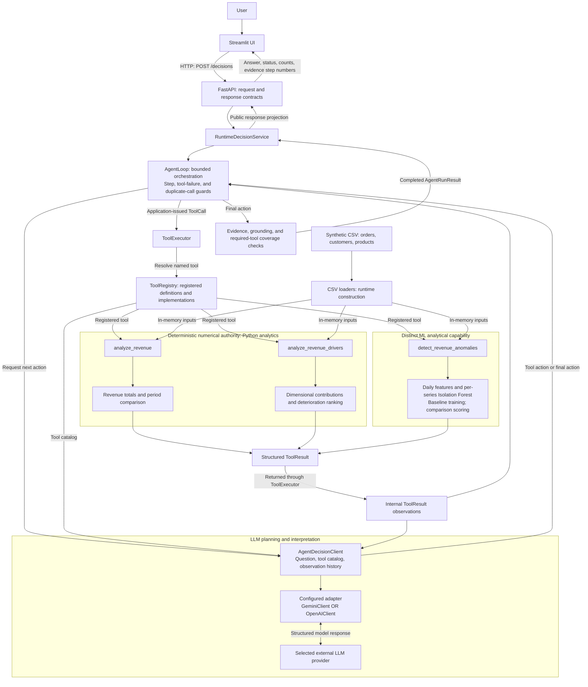

# DecisionAI

> An AI Engineering portfolio project for synthetic revenue investigation, combining deterministic analytics, anomaly detection, and bounded LLM tool use to produce evidence-backed findings and investigation recommendations.

This is an unpublished, history-free, source-only public portfolio candidate derived from source commit `09f15b549c60b8703123624e5a9ff92fd9e4ac39`. The operational AWS deployment workflow and original Git history are excluded. See the [source release manifest](docs/source-release-manifest.md) for scope and validation status.

## Project status

**Phase 19 — Portfolio release preparation.** Publication remains subject to documentation, licensing, privacy, and human review.

The portfolio is intended for AI Engineering reviewers and technical leads. The intended product user is a business analyst; analyst usefulness, productivity, and trust benefits have not been validated.

DecisionAI currently includes:

- deterministic revenue analytics
- ML-based anomaly detection
- provider-neutral LLM integration
- Gemini and OpenAI adapters
- grounded tool-using agent workflows
- structured evidence and provenance
- evaluation and error-analysis pipelines
- FastAPI backend
- Streamlit interface
- reliability, security, and observability foundations
- optimization metrics for tool usage, failures, duplication, and latency

Fresh Phase 19.2 local offline verification for revision `7049c487805682601b28e720dd90ba5734e3d07c`:

```text
Python 3.14.6
Ruff passed
39 focused tests passed
741 full tests passed; 1 google-genai deprecation warning
Independent Decimal calculations reproduced the synthetic scenario
```

See [release evidence](docs/portfolio-release-evidence.md) for commands, dataset hashes, historical results, and the documentation working-tree caveat. These local results do not establish live provider quality, current CI success, current AWS readiness, or production readiness.

---

## What problem does DecisionAI solve?

Business users often have data but still struggle to answer questions such as:

> What is affecting revenue performance, and what should I investigate first?

DecisionAI is designed to answer this type of question by combining deterministic calculations with LLM-based planning and interpretation.

The core principle is:

> **The LLM decides what evidence is needed. Deterministic tools calculate the business facts.**

The language model is not trusted as a calculator.

---

## Example workflow

For a question such as:

```text
Compare revenue from July 2025 with August 2025.
What is affecting revenue performance, and what should I investigate first?
```

DecisionAI can:

1. calculate the total revenue comparison with a deterministic analytics tool
2. analyze the largest observed deteriorations across business dimensions
3. preserve tool outputs as structured evidence
4. generate a grounded answer referencing that evidence
5. recommend an investigation priority without claiming causality

Primary portfolio scenario: `revenue_decline_v1`, comparing July 1–31 with August 1–31, 2025. Phase 19.2 independently reproduced these synthetic calculations:

```text
July 2025 revenue:   $1,773,419.93
August 2025 revenue: $1,275,769.95
Absolute change:      -$497,649.98
Percentage change:    -28.06%
Computing change:     -$451,913.17
```

Observed deteriorations are treated as associations/contributions, **not causal proof**.

Computing is the largest category deterioration and an investigation priority. Contributions across overlapping dimensions cannot be added as independent explanations. The written walkthrough links calculations to evidence and separates findings from recommendations. No recording or screenshots were created for this documentation increment. Saved provider answers are historical executions, not a current live demonstration.

## Supported capabilities and limitations

| Supported capability | Explicit limitation |
|---|---|
| Deterministic revenue comparison and contributor ranking | Observed change does not establish causality |
| Statistical baseline and per-series Isolation Forest | Anomaly scores and baseline agreement are not labeled detection accuracy |
| Gemini and OpenAI adapters | Offline tests do not establish live quality, provider parity, availability, or automatic failover |
| Bounded single-agent tool orchestration | Supported revenue workflow, not unrestricted autonomous analysis |
| Internal evidence references and evaluation machinery | References do not prove every narrative claim; public API/UI expose step numbers rather than structured observations or grounded claims |
| FastAPI and Streamlit application boundary | Local verification does not demonstrate unrestricted public readiness |
| Sanitized failures, request IDs, privacy-aware logs, in-process metrics | Defensive foundations rather than full production security or distributed telemetry |
| Docker, dependency locks, CI and AWS delivery workflows | Current builds, lock freshness, and cloud runtime were not verified in Phase 19.2 |

Product specifications and architecture documents include intended behavior as well as implemented boundaries. They are not a shipped-feature checklist; SQLite persistence is not claimed as implemented here.

---

## Architecture



This diagram shows implemented component responsibilities, not a recorded execution or a runtime-health guarantee. Registry arrows represent tool resolution and registration; the executor invokes the selected tool. Final checks run inside `AgentLoop`. Deterministic analytics calculate the business numbers; the LLM plans tool use and interprets evidence. ML anomaly scores indicate unusual behavior, not causality. The public API/UI do not expose full structured observations or grounded claims; these remain internal.

### Separation of responsibilities

**Python / deterministic analytics**
- revenue calculations
- period comparisons
- driver analysis
- contribution calculations
- structured business evidence

**Machine learning**
- anomaly detection with Isolation Forest
- evidence generation, not autonomous business conclusions

**LLM**
- intent interpretation
- next-action planning
- tool selection
- evidence synthesis
- grounded communication

---

## Agent design

DecisionAI currently uses a **bounded single-agent tool-using workflow**, with step and tool-failure limits. Provider SDK logic stays at the LLM boundary; authoritative numerical calculations stay in Python analytics code.

```text
QUESTION
  ↓
DECIDE NEXT ACTION
  ↓
TOOL CALL OR FINAL ANSWER
  ↓
OBSERVATION
  ↓
DECIDE AGAIN
```

A multi-agent architecture is intentionally deferred until evaluations demonstrate that it is necessary; see [ADR-005](docs/decisions/ADR-005-simple-orchestration-before-multi-agent.md).

### Evidence coverage

An important optimization completed in Phase 15 taught the agent to verify that all analytical needs in a multi-part question are covered before returning a final answer.

For example:

```text
"Compare revenue and identify the largest deteriorations."
```

requires both:

```text
aggregate comparison
+
driver analysis
```

while:

```text
"Report the revenue change only."
```

requires only the aggregate comparison.

This helps prevent both **under-tooling** and unnecessary **over-tooling**.

---

## Grounding and evidence

Tool observations are stored as structured evidence.

The agent must:

- use valid tool observations
- reference valid evidence steps
- avoid inventing evidence IDs
- avoid unsupported certainty
- avoid causal claims from contribution analysis
- avoid summing overlapping dimensional contributions

DecisionAI distinguishes between:

- facts
- inferences
- unknowns

Internal evidence supports technical inspection, but the current API/UI expose evidence step numbers without structured observations or grounded claims. Evidence references and automated semantic checks do not guarantee narrative correctness. Analyst-facing evidence inspection remains a proposal in [ADR-006](docs/decisions/ADR-006-validate-evidence-inspection-before-expansion.md), whose status is **Proposed**. Discovery and implementation require separate approval.

---

## Deterministic analytics

The revenue calculation is:

```text
revenue = quantity × unit_price × (1 - discount)
```

The analytics layer supports:

- baseline vs comparison period revenue
- absolute change
- percentage change
- driver analysis across business dimensions
- contribution to total observed change

The current synthetic business dataset includes:

- orders
- customers
- products

with dimensions such as:

- region
- segment
- category
- sales channel

---

## Machine learning

DecisionAI includes anomaly detection based on **Isolation Forest**.

Example daily features include:

- daily revenue
- order count
- units sold
- average order value
- average discount

An anomaly is treated as:

> evidence worth investigating

not as:

> proof of cause

---

## LLM provider abstraction

The core agent does not depend directly on a specific provider SDK.

Current provider adapters:

- **Gemini**
- **OpenAI**

Gemini is the current default provider.

Provider selection is configuration-driven:

```text
LLM_PROVIDER=gemini
```

or:

```text
LLM_PROVIDER=openai
```

Provider-specific SDK logic stays at the edge of the architecture.

---

## Evaluation framework

DecisionAI includes an evaluation system for agent behavior, not only unit tests.

Current evaluation dimensions include:

- agent completion
- required tool coverage
- tool selection
- numeric ground truth
- semantic safety
- causal-overclaim detection
- unsupported-certainty detection
- recommendation presence
- duplicate tool calls
- tool success rate
- tool failures
- agent steps
- tool-call count
- latency
- provider availability

Quality failures and provider availability failures are measured separately.

This matters because:

```text
bad agent decision != provider outage
```

---

## Historical Phase 15 optimization results

The following results are historical, narrow-case provider observations reported in the [Phase 15 summary](docs/PHASE_15_EVALUATION_SUMMARY.md), not fresh Phase 19.2 provider evaluations or general reliability estimates.

Before optimization, the complex revenue case produced:

```text
Required tool coverage: 50%
Ground truth:            0%
Semantic safety:         100%
Overall result:          FAIL
```

After root-cause analysis, the evidence-coverage policy was improved.

A real Gemini evaluation then produced:

```text
Used tools:
- analyze_revenue
- analyze_revenue_drivers

Required tool coverage: 100%
Ground truth:            100%
Semantic safety:         100%
Overall result:          PASS

Steps:                   3
Tool calls:              2
Tool failures:           0
Duplicate calls:         0%
Latency:                 ~9.39 s
```

A simple comparison-only case correctly used only:

```text
analyze_revenue
```

and also passed with 100% tool selection, ground truth, and semantic safety.

A subsequent complex-case check recorded **3 requested, 3 attempted, 2 quality-evaluated, 2 passed, and 1 provider quota failure**. The later comparison-only artifact recorded **0 quality-evaluated runs** and null quality metrics; its earlier single-run pass above is reported separately in the summary. Numeric ground-truth checks assess tool outputs, not every generated statement. Small samples and provider-dependent latency do not support broad quality or performance claims.

---

## Observability

Current observability includes structured logging and in-process metrics such as:

- `requests_total`
- `provider_errors_total`
- `agent_completed_total`
- `agent_failed_total`
- `tool_calls_total`
- `llm_calls_total`

A `/metrics` endpoint exposes current metrics.

Future production work may extend this to external telemetry systems such as Prometheus/OpenTelemetry.

---

## Reliability and safety principles

DecisionAI follows several project rules:

- deterministic tools calculate business metrics
- LLMs are instructed to use tool observations; grounding and evaluation constrain and check behavior
- provider failures are mapped separately from AI-quality failures
- expected tool errors are structured
- controlled `ToolExecutionError` messages are preserved; unexpected ordinary tool exceptions become sanitized failed results (`Tool execution failed.`); `KeyboardInterrupt` and `SystemExit` propagate
- secrets are loaded from environment variables
- prompts and raw provider responses are not intentionally logged
- contribution/association does not imply causality
- human review remains appropriate for important business actions

---

## Repository structure

```text
app/
├── agent/
├── analytics/
├── api/
├── evaluation/
├── llm/
├── ml/
├── observability/
└── tools/

scripts/
tests/
artifacts/
```

Key boundaries:

```text
agent/       orchestration and decision logic
analytics/   deterministic business calculations
evaluation/  quality and optimization measurement
llm/         provider adapters and abstractions
ml/          anomaly detection
tools/       agent-callable deterministic capabilities
api/         FastAPI application
```

---

## Running tests

From the existing project virtual environment, without bytecode or repository cache writes:

```powershell
.\.venv\Scripts\python.exe -B -m ruff check . --no-cache
.\.venv\Scripts\python.exe -B -m pytest -q -p no:cacheprovider
```

Recorded Phase 19.2 result at `7049c487…`:

```text
741 passed, 1 warning in 55.89s
```

See [release evidence](docs/portfolio-release-evidence.md) for the focused command, warning, and environment/access caveat. Passing offline tests does not prove live provider quality. CI uses its own locked environment and also checks lock freshness and Docker builds.

---

## Environment variables

Do not commit API keys.

Example PowerShell configuration:

```powershell
$env:LLM_PROVIDER="gemini"
$env:GEMINI_API_KEY="<your-local-key>"
```

For the OpenAI adapter:

```powershell
$env:LLM_PROVIDER="openai"
$env:OPENAI_API_KEY="<your-local-key>"
```

Keep real credentials only in your local environment or a secrets manager. These examples configure a provider; they do not authorize paid evaluations or establish availability.

## Historical delivery evidence

The [Phase 16 delivery record](docs/docker-cicd-cloud.md) reports CI and deployment success for `72642232fe1347e3f8f18a32a713fc255e313f8d`, including ECR publication, ECS task registration, and services reported at zero desired/running tasks.

The included [CI workflow](.github/workflows/ci.yml) configures locked dependencies, checks and Docker builds without AWS deployment. The [historical delivery record](docs/docker-cicd-cloud.md) describes originating-repository OIDC and exact tested-SHA delivery. Its operational workflow is excluded from this snapshot. Historical delivery does not establish current AWS health.

Independent offline candidate validation used Python 3.14.6: 748 full-suite tests passed with 1 warning; 123 evaluation tests passed with 1 warning; seven qualitative-review tests were collected and passed; Ruff and standard-library Decimal reproduction passed. These candidate results are separate from historical operational-repository verification. See the [source release manifest](docs/source-release-manifest.md) and [portfolio release evidence](docs/portfolio-release-evidence.md).

Fresh dependency installation, dependency lock freshness, Docker builds, candidate GitHub Actions execution, live provider and AWS runtime, and final publication approval remain unverified. Matching installed versions in an existing environment does not establish fresh-install reproducibility.

---

## Evaluation artifacts

Phase 15 evaluation artifacts are stored under:

```text
artifacts/phase15/
```

including provider-specific outputs for cases such as:

```text
revenue_decline_v1
revenue_comparison_only_v1
```

These artifacts make optimization decisions traceable.

---

## Engineering philosophy

DecisionAI is being built around this loop:

```text
PLAN
  ↓
BUILD
  ↓
TEST
  ↓
EVALUATE
  ↓
ERROR ANALYSIS
  ↓
DECIDE
  ↓
ITERATE
```

The project intentionally avoids adding architectural complexity without evaluation evidence.

Examples:

- no multi-agent system just because multi-agent systems are fashionable
- no RAG/vector database for structured business data that does not currently require it
- no optimization without a measurable problem
- no causal claims from correlational evidence

---

## Roadmap

Completed:

```text
Phase 0   Foundation                         ✅
Phase 1   Product Spec                       ✅
Phase 2   Architecture                       ✅
Phase 3   Data                               ✅
Phase 4   Deterministic Analytics            ✅
Phase 5   ML                                 ✅
Phase 6   Gemini Foundation                  ✅
Phase 7   Grounding / Context Engineering    ✅
Phase 8   Tool System                        ✅
Phase 9   Agentic Workflow                   ✅
Phase 10  Evaluation Framework               ✅
Phase 11  Error Analysis                     ✅
Phase 12  FastAPI + Streamlit                ✅
Phase 13  Security / Reliability             ✅
Phase 14  Observability                      ✅
Phase 15  Optimization                       ✅
```

Later phase records and current preparation:

```text
Phase 16  Docker + CI/CD + Cloud             Historical delivery recorded
Phase 17  Coding Agent Lab                  Engineering workflow documented
Phase 18  Shaping / Communication / Leadership  Exercises completed
Phase 19  Portfolio Release                 Preparation; publication pending
Phase 20  Continuous Learning               Future
```

---

## Current limitations

This is an active engineering project, not a production SaaS release.

Current limitations include:

- synthetic evaluation data
- limited real-world business datasets
- small live multi-run sample sizes
- provider rate/quota variability
- in-process metrics rather than full production telemetry
- current cloud runtime, CI success, Docker builds, and lock freshness are unverified
- structured analyst-facing evidence inspection is not implemented
- analyst benefits and production readiness are unvalidated
- human review is still expected for important business decisions

These limitations are tracked intentionally rather than hidden.

See the [product specification](docs/product-spec.md), [architecture](docs/architecture.md), [coding-agent lab](docs/coding-agent-lab.md), and [Phase 18 leadership record](docs/shaping-communication-leadership.md). Phase 18's conditional go authorizes preparation only, not publication, discovery, provider spend, or cloud activation. The release scope does not add tools, multi-agent systems, or autonomous business actions.

---

## Why this project exists

DecisionAI is being developed as a practical AI Engineering project focused on the parts that matter beyond a chatbot demo:

- deterministic computation
- tool use
- agent orchestration
- structured evidence
- provider abstraction
- evaluation
- error analysis
- reliability
- observability
- optimization
- deployment

The goal is to build a system whose AI behavior can be **measured, debugged, and improved**.

---

## License and publication privacy review

DecisionAI's original application source, project scripts, documentation, Mermaid diagrams, and project-generated synthetic datasets are licensed under the [MIT License](LICENSE). Copyright (c) 2026 Alexandro Bazán Guardia. Third-party dependencies retain their own licenses. Historical provider artifacts are not included in the initial source release.

Dependency-license compliance and third-party attribution review remain pending, including any later distribution of containers or selected external artifacts. Selecting MIT does not complete those reviews or authorize publication.

Public-artifact privacy review is also pending: select necessary evidence and check credentials, private payloads, personal information, and cloud identifiers for unintended disclosure. Displaying selected evidence does not authorize logging raw prompts, arguments, or outputs. Human publication approval is required; no recording, screenshots, or public production service are claimed by this increment.
