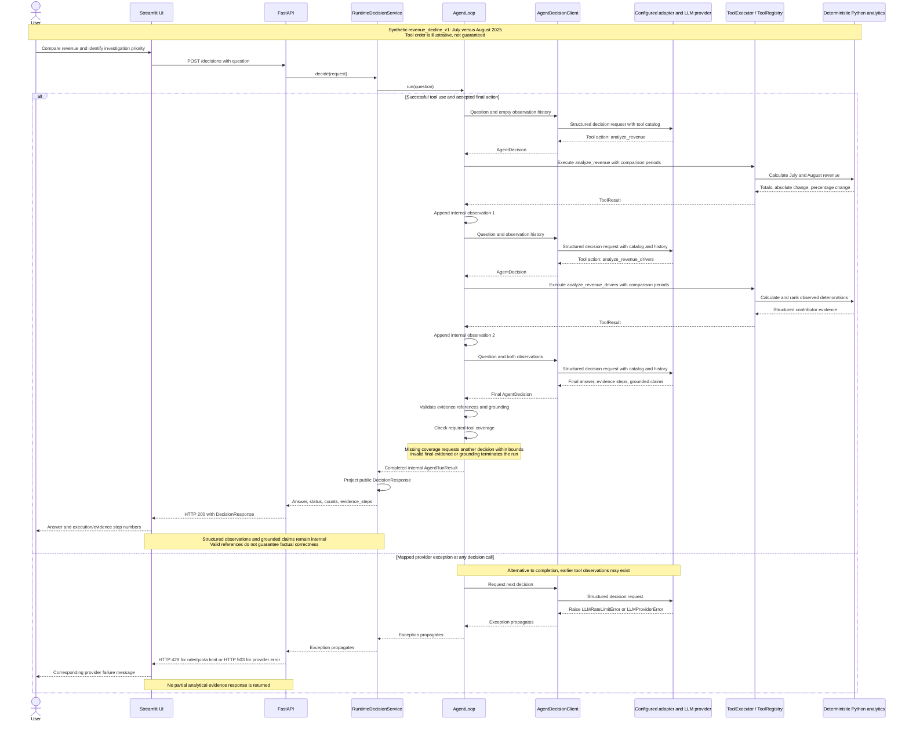
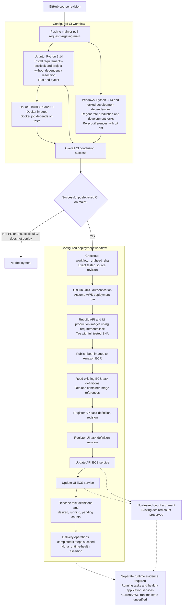

# DecisionAI portfolio release evidence

This unpublished source-only candidate derives from `09f15b549c60b8703123624e5a9ff92fd9e4ac39` without original Git history or the operational deployment workflow. See the [source release manifest](source-release-manifest.md). Historical checks below are not candidate validation.

## Scope and provenance

This document preserves the Phase 19.2 local verification reported in this engineering session for revision:

```text
7049c487805682601b28e720dd90ba5734e3d07c
```

The results below were executed during Phase 19.2, not rerun when this documentation was written. This is a human-reviewable record, not a CI log or a new live evaluation. Phase 19.3 changes documentation only. Publication remains pending.

The target is the existing synthetic `revenue_decline_v1` scenario. Python analytics code is the numerical authority; bounded LLM orchestration selects tools and interprets their evidence. No analyst validation, causal attribution, live provider reliability, current AWS health, or production readiness is established.

## Working-tree caveat

Before and after Phase 19.2, `git status --short` reported:

```text
 D docs/docker-cicd-cloud
 D docs/observability
?? docs/docker-cicd-cloud.md
?? docs/observability.md
```

These pre-existing documentation changes were preserved. No code, test, or dataset changes were reported by Git. The baseline is the stated HEAD plus disclosed documentation changes, not a clean checkout. The later documentation reconciliation was committed as `fa446c4`; final candidate revision selection remains pending. The Phase 19.3 README and this new document are subsequent documentation changes, not part of the tested commit.

Subsequent Phase 19.4 reconciliation retains the same document bytes under `docs/docker-cicd-cloud.md` and `docs/observability.md` and updates active links. The historical Phase 19.2 snapshot above remains unchanged. The content-preserving filename reconciliation and link updates were recorded in originating commit `fa446c4`. Later privacy edits generalized documentation identifiers.

## Fresh local verification recorded in Phase 19.2

The explicit project interpreter was `.venv/Scripts/python.exe`, Python **3.14.6, 64-bit**. The shell's default Python pointed to another project's environment, so it was not used for verification. No packages were installed and no environment was created.

Commands ran from the repository root. `-B`, Ruff `--no-cache`, and pytest `-p no:cacheprovider` disabled bytecode and repository cache writes. Persistence tests used temporary fixtures outside the repository; provider tests used mocks/fakes. No live provider evaluation scripts, GitHub workflows, or AWS calls were executed.

| Executed command | Exit code | Recorded result |
| --- | ---: | --- |
| `git rev-parse HEAD` | 0 | Revision above |
| `git status --short` | 0 | Working-tree state above, unchanged after verification |
| `git diff --stat` | 0 | Two tracked documentation deletions, 1,077 deleted lines; untracked files are not included |
| `.\.venv\Scripts\python.exe -B -c "import sys; print(sys.executable); print(sys.version); print(sys.prefix); print(sys.base_prefix)"` | 0 | Existing project environment and Python version confirmed |
| `.\.venv\Scripts\python.exe -B -m ruff check . --no-cache` | 0 | All checks passed |
| `.\.venv\Scripts\python.exe -B -m pytest -q -p no:cacheprovider tests/analytics tests/evaluation/test_ground_truth.py tests/evaluation/test_cases.py tests/evaluation/test_case_registry.py` | 0 | **39 passed in 4.23s**, no warnings |
| `.\.venv\Scripts\python.exe -B -m pytest -q -p no:cacheprovider` | 0 | **741 passed, 1 warning in 55.89s** |
| `$verificationCode \| .\.venv\Scripts\python.exe -B -` | 0 | In-memory standard-library Decimal calculation and SHA-256 hashing passed |
| `Get-FileHash data/orders.csv,data/customers.csv,data/products.csv -Algorithm SHA256 \| Format-List` | 0 | Dataset hashes corroborated |
| `git diff --check` | 0 | No whitespace errors |

The full-suite warning originated at `.venv/Lib/site-packages/google/genai/types.py:42`:

```text
DeprecationWarning: '_UnionGenericAlias' is deprecated and slated
for removal in Python 3.17
```

Initial interpreter, Ruff, and focused-test attempts each exited **1** before execution because the sandbox denied access to the base executable at `<BASE_PYTHON_EXECUTABLE>`. Approved execution outside the sandbox succeeded. Those attempts were environment/access failures, not product defects or failing tests.

## Independent synthetic calculations

The executed standard-library script read CSV files with `csv.DictReader`, used `Decimal` precision 40, joined orders to products by product ID, and filtered July/August 2025. It imported no application analytics code. It checked unique product/customer lookup IDs, order references, positive quantities, nonnegative prices, and discounts between zero and one.

| Metric | Fresh Phase 19.2 Decimal result |
| --- | ---: |
| July revenue | 1,773,419.930216 |
| August revenue | 1,275,769.945404 |
| Absolute change | −497,649.984812 |
| Percentage change | −28.06159874110510006049232704119528946486% |
| Computing July revenue | 1,060,508.322563 |
| Computing August revenue | 608,595.153978 |
| Computing deterioration | −451,913.168585 |
| Computing contribution to net change | 90.80944084741040408011497471875059987619% |

Computing was independently confirmed as the largest category deterioration. All four aggregate metrics matched the historical case expectations in `artifacts/phase15/gemini/revenue_decline_v1_eval.json` within their declared tolerances. Monetary discrepancies from stored floating-point values were at most `3E-10`; the percentage-ratio discrepancy was approximately `1.494E-16`.

The passing full suite also includes [end-to-end dataset validation](../tests/data/test_data_pipeline.py) against schema, required-field, business-rule, and referential-integrity contracts. This is distinct from the independent script's narrower checks.

### Dataset identities

SHA-256 hashes represent the exact CSV bytes used for the calculation:

| File | Data rows | SHA-256 |
| --- | ---: | --- |
| [orders.csv](../data/orders.csv) | 2,250 | `f9413e8de87ce1692301628a4e9f522be9ee891020de1eb81558fa9287df5cba` |
| [customers.csv](../data/customers.csv) | 300 | `8773b27df9411da7c773552b895a6885241ba3cc8e6f5ee1a0e01f82c20d1024` |
| [products.csv](../data/products.csv) | 20 | `de96c95d342c9f9f5e41ff6d3067514e86f70532e43768be9b430c00d37e93d0` |

### Illustrative reproduction recipe

The following is a **reconstructed reference example**, not the original executed script or command body. It was not executed when the reference example was first documented; a subsequent human-executed reproduction is recorded under “Phase 19.3D — Offline demonstration reproduction result” below. It illustrates the standard-library calculation without adding an executable repository script. Run from the repository root in an existing interpreter if separately desired.

```python
import csv
import hashlib
from decimal import Decimal, getcontext
from pathlib import Path

getcontext().prec = 40
tables = {}
for name in ("orders", "customers", "products"):
    path = Path("data") / f"{name}.csv"
    with path.open(encoding="utf-8-sig", newline="") as stream:
        tables[name] = list(csv.DictReader(stream))
    print(name, len(tables[name]), hashlib.sha256(path.read_bytes()).hexdigest())

products = {row["product_id"]: row for row in tables["products"]}
customers = {row["customer_id"]: row for row in tables["customers"]}
assert len(products) == len(tables["products"])
assert len(customers) == len(tables["customers"])
totals = {month: Decimal(0) for month in ("2025-07", "2025-08")}
categories = {month: {} for month in totals}
for row in tables["orders"]:
    assert row["customer_id"] in customers
    assert row["product_id"] in products
    quantity, price, discount = (
        Decimal(row[field]) for field in ("quantity", "unit_price", "discount")
    )
    assert quantity > 0 and price >= 0 and 0 <= discount <= 1
    month = row["order_date"][:7]
    if month not in totals:
        continue
    revenue = quantity * price * (1 - discount)
    totals[month] += revenue
    category = products[row["product_id"]]["category"]
    categories[month][category] = categories[month].get(category, Decimal(0)) + revenue

change = totals["2025-08"] - totals["2025-07"]
deltas = {
    category: categories["2025-08"].get(category, Decimal(0))
    - categories["2025-07"].get(category, Decimal(0))
    for category in set(categories["2025-07"]) | set(categories["2025-08"])
}
print("July", totals["2025-07"])
print("August", totals["2025-08"])
print("Change", change)
print("Percentage change", change / totals["2025-07"] * 100)
print("Computing July", categories["2025-07"]["Computing"])
print("Computing August", categories["2025-08"]["Computing"])
print("Computing change", deltas["Computing"])
print("Computing contribution percent", deltas["Computing"] / change * 100)
print("Largest category deterioration", min(deltas, key=deltas.get))
```

## Primary portfolio walkthrough

Use the existing [registered case](../app/evaluation/case_registry.py): compare July 1–31 against August 1–31, 2025, identify the largest observed deteriorations, and recommend what to investigate first.

1. Explain synthetic data identity and the deterministic revenue formula.
2. Show aggregate comparison and Computing deterioration from the verified calculations.
3. Explain why the case requires `analyze_revenue` and `analyze_revenue_drivers`; anomaly detection is optional.
4. Inspect selected historical tool evidence and distinguish facts from interpretation and investigation priority.
5. Explain that observed contribution is not causality and overlapping dimensions cannot be summed as independent explanations.

This is a written walkthrough. No recording or screenshots were created by this increment. Saved provider answers are historical executions; a future scripted replay must be labeled scripted and cannot demonstrate current live-model reasoning. The current API/UI show evidence step numbers, not structured observations or grounded claims.

An optional ML explanation can show the historical-training/comparison-scoring boundary. Exact anomaly counts depend on configuration: [ML documentation](ml-engine.md) discusses contamination `0.08`, while the [synthetic scenario test](../tests/ml/test_synthetic_scenario.py) uses `0.1`. Neither scores nor baseline agreement establish labeled detection accuracy.

Local live provider execution and AWS runtime demonstrations require separate authorization. They are not prerequisites for this written offline evidence baseline.

### Revenue investigation sequence

**Illustrative implementation sequence; not an execution trace.**



The successful branch illustrates one valid tool order, not a fixed execution plan. Optional anomaly detection, detailed tool-error handling, and provider-specific retries are omitted. Noncompleted agent results are projected as HTTP 200 with `status="failed"`; that guardrail path is not drawn. The provider-failure branch is a separate alternative at any model decision call, not a continuation after HTTP 200. Grounding checks validate references and coverage, not the factual correctness of every narrative claim.

## Historical provider and delivery evidence

| Source | Historical evidence | Limit |
| --- | --- | --- |
| Phase 15 complex-case artifact: `artifacts/phase15/gemini/revenue_decline_v1_eval.json` | Gemini `gemini-2.5-flash`: 3 requested, 3 attempted, 2 quality-evaluated, 2 passed, 1 quota failure | Narrow sample; no fresh provider execution |
| Phase 15 comparison-only artifact: `artifacts/phase15/gemini/revenue_comparison_only_v1_eval.json` | 3 requested, 1 attempted, 0 quality-evaluated; quality metrics null | Cannot infer a quality pass from this artifact |
| [Phase 15 summary](PHASE_15_EVALUATION_SUMMARY.md) | Earlier single-run comparison pass and complex-case optimization; historical 706-test checkpoint | Separate reported observation; not today's count or broad reliability |
| Phase 11 qualitative review: `artifacts/phase11/revenue_decline_v1_qualitative_review.json` | Automated semantic pass alongside unresolved causal-language assessment and unsuccessful qualitative review | Automated passing checks do not settle every interpretation concern |
| [Phase 16 delivery record](docker-cicd-cloud.md) | 735-test clean-environment result; CI/deployment reported successful for `72642232fe1347e3f8f18a32a713fc255e313f8d`; ECR publication, ECS registration, zero desired/running tasks | Historical documentation, not independently refreshed cloud/run evidence |

The historical JSON artifacts named above are local provenance references, not tracked files available in a clean checkout. Their paths are intentionally plain text rather than links. The tracked Phase 15 summary remains available; publication of artifact files is outside this editorial increment.

The included [CI](../.github/workflows/ci.yml) configures locked dependencies, Ruff, pytest, lock freshness checks and Docker builds. The [historical delivery record](docker-cicd-cloud.md) describes originating-repository OIDC and tested-SHA deployment; the executable deployment workflow is excluded from this snapshot.

Workflow configuration, successful delivery, and running-service health are different claims. Phase 19.2 did not regenerate locks, build containers, trigger workflows, or access AWS. A green CI run, ECR publication, or registered task definition does not prove a running service. Current CI/Deploy success, AWS health, secrets configuration, provider availability, and spending remain unverified.

### Configured CI/CD and AWS delivery

**Configured delivery flow; current runtime state unverified.** This is historical operational configuration, not an executable deployment pipeline included in this snapshot.



This diagram describes inspected workflow configuration, not a fresh deployment or AWS health check. Deployment **rebuilds images from the exact tested source using the production lock**; it does not promote the image binaries built by CI. Both task-definition revisions are registered before either service update. Service updates preserve the existing desired count and do not automatically scale services up.

The CI success node summarizes the workflow conclusion, not an additional job. Failed CI does not reach the successful deployment path; PR-based CI does not deploy. Dashed arrows indicate limitations and separate evidence requirements, not implemented runtime checks. The workflow describes service counts but does not wait for stability, perform an application smoke test, or implement automatic rollback. Successful builds, image publication, task registration, and service updates do not establish that application services are running and healthy.

## Offline portfolio demo — five-scene walkthrough

This written storyboard targets an approximately six-minute technical demonstration: 5 minutes 30 seconds of speaking plus transitions. It creates no recording or screenshots and performs no new execution. The inspected local HEAD is `f7b521a0584ab8ffb09dc8aa4aa622ef4543c3a6`; the Phase 19.2 verification remains associated with `7049c487805682601b28e720dd90ba5734e3d07c`. The architecture diagram in [README](../README.md) and the sequence diagram above illustrate component responsibilities and a possible execution path, not recorded traces. The delivery diagram describes configuration, not current AWS health.

### A. Business question and synthetic dataset — 45 seconds

**Show:** the registered question beside this document's dataset identities; optionally show CSV headers rather than full rows.

**Speaker notes:** “The question is what changed between July and August 2025 and what to investigate first. This is the existing synthetic revenue_decline_v1 scenario. Orders, customers, and products provide the structured inputs. File hashes identify the exact data used in the recorded calculation.”

**Evidence paths:** `app/evaluation/case_registry.py`, `app/evaluation/cases.py`, `tests/evaluation/test_cases.py`, `data/orders.csv`, `data/customers.csv`, `data/products.csv`, `docs/portfolio-release-evidence.md`.

**Caveat:** synthetic scenario results do not establish usefulness on real business data or analyst validation.

### B. Deterministic revenue comparison — 60 seconds

**Show:** the independent calculation table above and the revenue formula in `app/analytics/revenue.py`.

**Speaker notes:** “Python calculates quantity times unit price times one minus discount. The independently recorded Phase 19.2 totals are July 1,773,419.930216 and August 1,275,769.945404. The absolute change is -497,649.984812, approximately -28.06%. These numbers come from CSV arithmetic, not model generation.”

**Evidence paths:** `app/analytics/revenue.py`, `app/tools/revenue.py`, `tests/analytics/test_revenue.py`, `tests/evaluation/test_ground_truth.py`, `docs/portfolio-release-evidence.md`.

**Caveat:** these are recorded Phase 19.2 results, also reproduced by the subsequent human-executed Phase 19.3D calculation recorded below. The application stores percentage change as a ratio; multiply by 100 for percentage display. Independent arithmetic alone does not execute or validate the agent.

### C. Driver investigation — 60 seconds

**Show:** Computing's calculation table, the driver output contract in `app/tools/drivers.py`, and deterioration ranking in `app/analytics/drivers.py`.

**Speaker notes:** “Computing shows the largest category deterioration, -451,913.168585. Its large observed decline makes it a reasonable investigation priority. The ranking describes where revenue changed; it does not prove why it changed. Region, segment, category, and channel overlap, so their contributions cannot be added as independent explanations.”

**Evidence paths:** `app/analytics/engine.py`, `app/analytics/dimensions.py`, `app/analytics/drivers.py`, `app/tools/drivers.py`, `tests/analytics/test_ground_truth.py`.

**Caveat:** the registered numeric expectations check aggregate revenue metrics. The inspected scenario test checks Computing's category ranking and negative direction; its exact deterioration is supported by the recorded independent calculation.

### D. Agent orchestration and grounding — 90 seconds

**Show:** the README architecture diagram and the sequence diagram above, followed by final checks and public response fields.

**Speaker notes:** “A bounded single agent asks the configured model for its next action. The application executes registered tools and retains ToolResult observations internally. Before accepting a final action, it checks evidence references, grounding, and required-tool coverage. The tool order shown here is illustrative. The public response exposes the answer, status, counts, and evidence step numbers, not full observations or grounded claims. Valid references do not guarantee every narrative statement is correct.”

**Evidence paths:** `app/agent/runtime.py`, `app/agent/decision.py`, `app/agent/loop.py`, `app/agent/coverage.py`, `app/agent/grounding.py`, `app/tools/factory.py`, `app/tools/executor.py`, `app/api/service.py`, `app/api/contracts.py`, `app/ui/streamlit_app.py`, `README.md`.

**Caveat:** no live model or API/UI analysis is executed in this offline walkthrough. Provider failures are separate alternatives, not partial-evidence responses. The current interface does not provide complete public evidence inspection.

### E. Evaluation, trade-offs, and limitations — 75 seconds

**Show:** the Phase 19.2 verification table, tracked Phase 15 summary, ADR-005/006, and delivery diagram.

**Speaker notes:** “The recorded offline baseline passed Ruff, 39 focused tests, and 741 full tests with one dependency warning. Historical Phase 15 provider evidence is separate: three complex-case runs were attempted, two reached quality evaluation and passed, and one hit quota. That small sample does not establish broad reliability. Simple orchestration keeps the system inspectable; multi-agent expansion needs measured justification. ADR-006 remains Proposed. Delivery configuration is traceable to tested source, but current provider, cloud, and application runtime status are unverified.”

**Evidence paths:** `app/evaluation/ground_truth.py`, `docs/PHASE_15_EVALUATION_SUMMARY.md`, `docs/PHASE_15_OPTIMIZATION_DECISION_RECORD.md`, `docs/shaping-communication-leadership.md`, `docs/decisions/ADR-005-simple-orchestration-before-multi-agent.md`, `docs/decisions/ADR-006-validate-evidence-inspection-before-expansion.md`, `.github/workflows/ci.yml`, `docs/docker-cicd-cloud.md`.

**Caveat:** passing offline tests does not prove live provider quality, analyst benefit, causal attribution, production readiness, or current AWS health. Numeric ground-truth checks assess tool outputs rather than every generated sentence. Publication gates below remain pending.

### Optional offline reproduction — proposed commands only

The commands below were originally proposed instructions, not an execution record. A human subsequently reported executing the recipe pipeline; its supplied output is recorded in the next subsection. This does not establish execution of every preparation command below. For any future reproduction, use the repository root and existing project interpreter. First inspect revision, working-tree state, and dataset hashes:

```powershell
git rev-parse HEAD
git status --short
Get-FileHash data/orders.csv,data/customers.csv,data/products.csv -Algorithm SHA256
```

Extract the existing reconstructed Decimal reference recipe without creating a script file. Require exactly one Python block and display it for manual review:

```powershell
$demoDocument = Get-Content -Raw -Encoding utf8 docs/portfolio-release-evidence.md
$demoRecipeMatches = [regex]::Matches($demoDocument, '(?s)```python\r?\n(.*?)```')
if ($demoRecipeMatches.Count -ne 1) {
    throw 'Expected exactly one Decimal reference recipe.'
}
$demoRecipe = $demoRecipeMatches[0].Groups[1].Value
if ([string]::IsNullOrWhiteSpace($demoRecipe)) {
    throw 'Decimal reference recipe is empty.'
}
$demoRecipe
```

**Stop and manually review the complete extracted Python code before execution.** Confirm standard-library imports only, explicit synthetic `data/` inputs, and no writes, provider calls, application startup, or network access. Do not run the following separate command until that review is complete:

```powershell
$demoRecipe | .\.venv\Scripts\python.exe -B -
```

Compare output and hashes with the recorded tables above. Label any future execution “new offline reproduction using the reconstructed reference recipe,” not the original Phase 19.2 command body. This recipe independently checks arithmetic; it does not execute tools, tests, or the agent. If the existing interpreter cannot run, report an environment failure without installing packages or creating another environment. Do not launch Streamlit/FastAPI or click Analyze for this offline procedure: the normal application path invokes the configured LLM.

### Phase 19.3D — Offline demonstration reproduction result

A human reported successfully executing the reconstructed reference recipe with this exact command:

```powershell
$demoRecipe | .\.venv\Scripts\python.exe -B -
```

This is a **new human-executed, independent offline calculation**, not the original Phase 19.2 script. The terminal output below was supplied by the human and was not rerun by the documentation agent. No execution timestamp, exact execution revision, or process exit code was supplied; none is inferred.

```text
orders 2250 f9413e8de87ce1692301628a4e9f522be9ee891020de1eb81558fa9287df5cba
customers 300 8773b27df9411da7c773552b895a6885241ba3cc8e6f5ee1a0e01f82c20d1024
products 20 de96c95d342c9f9f5e41ff6d3067514e86f70532e43768be9b430c00d37e93d0
July 1773419.930216
August 1275769.945404
Change -497649.984812
Percentage change -28.06159874110510006049232704119528946486
Computing July 1060508.322563
Computing August 608595.153978
Computing change -451913.168585
Computing contribution percent 90.80944084741040408011497471875059987619
Largest category deterioration Computing
```

Comparison of the supplied output with the recorded Phase 19.2 tables succeeds: all three dataset hashes and row counts match exactly, and all displayed Decimal revenue, change, percentage, and Computing values match numerically. Computing is again reported as the largest category deterioration. This corroborates synthetic-data arithmetic only; it does not verify agent execution, provider quality, API/UI behavior, CI, or AWS runtime.

Computing's approximately **90.81%** contribution is its observed revenue change divided by the total net revenue change, multiplied by 100. It is an observed ratio, not causal attribution; contributions across overlapping dimensions cannot be added as independent explanations. The original Phase 19.2 checks and historical provider evidence remain separate records.

### Historical examples and presentation boundaries

Prefer the tracked [Phase 15 summary](PHASE_15_EVALUATION_SUMMARY.md) for a clean-checkout presentation. Local historical artifacts are untracked and ignored; they are not shipped repository evidence:

- **Historical Phase 15 provider evidence:** `artifacts/phase15/gemini/revenue_decline_v1_eval.json` contains saved answers, grounded claims, numeric evaluation results, and run metrics. Selected synthetic excerpts can illustrate interpretation after disclosure/privacy review; it is not a full observation trace or current model execution.
- **Historical comparison-only availability evidence:** `artifacts/phase15/gemini/revenue_comparison_only_v1_eval.json` records zero quality-evaluated runs in the later attempt. Do not present it as a passing quality evaluation.
- **Older Phase 09 observation examples:** `artifacts/phase09/real_agent_eval.json` contains structured tool observations, sequences, answers, and claims from older runs. Its stronger “primary factor” language merits critical discussion, not endorsement as causal evidence.

Do not combine Phase 09 observations and Phase 15 answers, or excerpts from separate runs, into a purported single execution trace. Display only selected synthetic numerical fields and reviewed answer excerpts; do not expose whole artifacts, unrestricted payloads, prompts, credentials, or private error text. Missing local artifacts should be disclosed, not reconstructed as historical outputs.

The authoritative format is this written walkthrough with supporting diagrams. A future optional screen recording may follow the same scenes, but no recording or screenshots are claimed here. Analyst validation, live provider execution, measured general reliability, production readiness, and current AWS health remain unverified. The existing license, privacy, revision-selection, and human-publication approval gates still apply.

## Later originating-repository test discovery verification

The content-preserving rename of the qualitative-review test to `.py` was subsequently committed as `55116fc`. The checks ran against originating HEAD `58d9b5f` plus the unstaged rename, not against this candidate. Exactly seven tests were collected; 7 focused tests and 123 evaluation tests passed, Ruff passed, and the full suite passed **748 tests, 1 warning in 31.65s**. The evaluation suite took 13.68s with one warning; focused tests took 0.27s and collection took 0.38s. Successful checks exited 0. The warning was the same google-genai deprecation described above. An initial collection launch encountered sandbox access denial before approved execution succeeded. These historical results are separate from Phase 19.2's 741-test record and do not establish candidate validation or live-provider quality.

## Independent public-candidate verification — Phase 19.4

These checks were executed from the isolated candidate root using the originating repository's existing `.venv-locktest`, Python **3.14.6**. Application import-origin assertions resolved to the candidate. Installed metadata matched **67 production** and **73 development** lock entries exactly. This establishes version agreement in an existing environment, not fresh-install reproducibility. The candidate derives from source `09f15b549c60b8703123624e5a9ff92fd9e4ac39` and has no candidate Git revision yet.

For the command record, `$P` denotes the verified external interpreter and `$T` denotes a unique, verified-new temporary directory outside both repositories. Pytest ran with `PYTEST_DISABLE_PLUGIN_AUTOLOAD=1`, provider credential variables removed from the test processes without reading their values, and dataset resolution directed to candidate `data/`. Python `-B`, pytest `-p no:cacheprovider`, and Ruff `--no-cache` prevented bytecode and repository cache writes.

| Executed check / command | Exit | Result | Duration |
| --- | ---: | --- | ---: |
| Interpreter/version and application import-origin assertions using `$P -B -c` | 0 | Python 3.14.6; candidate import verified | 0.19s wall |
| `$P -B -m pytest --collect-only -q -p no:cacheprovider --basetemp "$T" tests/evaluation/test_qualitative_review.py` | 0 | 7 collected; no warnings | 0.39s |
| `$P -B -m pytest -q -p no:cacheprovider --basetemp "$T" tests/evaluation/test_qualitative_review.py` | 0 | 7 passed; no warnings | 0.24s |
| `$P -B -m pytest -q -p no:cacheprovider --basetemp "$T" tests/evaluation` | 0 | 123 passed; 1 warning | 14.52s |
| `$P -B -m ruff check . --no-cache` | 0 | All checks passed | 0.91s wall |
| `$P -B -m pytest -q -p no:cacheprovider --basetemp "$T"` | 0 | **748 passed; 1 warning** | **31.80s** |

The evaluation and full-suite warning originated in `google/genai/types.py:42`: `DeprecationWarning: '_UnionGenericAlias' is deprecated and slated for removal in Python 3.17`. Initial source-status verification encountered the sandbox user's Git ownership restriction; approved execution outside the sandbox succeeded without changing Git configuration. This was an environment/access issue, not a product failure.

Before and after testing, all **253 candidate file hashes** matched. No unexpected candidate files appeared, and the original repository remained clean. Four temporary `.joblib` files were observed outside both repositories; existing temporary directories were not reused or cleared. The five prior documentation adaptations and manifest remained unchanged during execution. All 247 unchanged exported files retained their previously verified source-blob identities, including application code, tests, scripts, datasets, locks, LICENSE, Dockerfiles and CI. Original Git history/metadata and the operational deployment workflow remained absent. This evidence-recording edit subsequently changes only the two authorized documents; it does not claim their new text was part of the executed test baseline.

### Candidate standard-library Decimal reproduction

The single reconstructed CSV/Decimal recipe in this document was manually reviewed before execution. It ran from the candidate root with Python 3.14.6 using `$recipe | & $python -B -S -`, where `$python` denotes the verified external interpreter. Exit code: **0**. `-S` disabled site initialization; only standard-library code and read-only candidate CSV inputs were used. No agents, models, providers, pandas, tests or network operations were invoked.

| Candidate LF CSV | Data rows | SHA-256 |
| --- | ---: | --- |
| [orders.csv](../data/orders.csv) | 2250 | `c334e35aeec72863e63dbafdd427b6c582dc8078f503af5d58196ffa88dc3e03` |
| [customers.csv](../data/customers.csv) | 300 | `0352e1debc5968e46810dbf14eb6537c1c2b10c7f84246dadd6c5e1f19ef264a` |
| [products.csv](../data/products.csv) | 20 | `b2aa9d7310832614d6a3daaeed7c62c6583fb2d94c45d796d012ccbb51f9ab26` |

| Calculated metric | Candidate result |
| --- | ---: |
| July revenue | 1773419.930216 |
| August revenue | 1275769.945404 |
| Absolute change | -497649.984812 |
| Percentage change | -28.06159874110510006049232704119528946486% |
| Computing July | 1060508.322563 |
| Computing August | 608595.153978 |
| Computing change | -451913.168585 |
| Computing contribution | 90.80944084741040408011497471875059987619% |

Computing was again the largest category deterioration. No numerical differences from the historical calculations were observed. Computing's contribution is the category revenue change divided by overall net change, expressed as a percentage: an observed decomposition, not causal attribution. Overlapping dimensional contributions cannot be summed as independent explanations.

Historical operational working-copy hashes above are based on **CRLF** bytes and remain unchanged as historical evidence. Candidate CSVs contain **LF** bytes and match their fixed originating Git blobs exactly. CRLF-to-LF normalization yields identical text. The three differing raw-byte hashes therefore reflect line endings, not a numerical or dataset-content discrepancy. All 253 candidate hashes remained unchanged after reproduction; no output artifacts were written and the operational repository remained clean.

Fresh dependency installation, lock regeneration/freshness, Docker builds, actual candidate GitHub Actions execution, live provider quality, AWS runtime, and final public-disclosure approval remain **unverified**. Candidate tests and arithmetic do not establish production readiness, analyst validation or causal correctness. Original Phase 19.2 verification, later originating-repository 748-test evidence, and these new candidate results are separate records.

## Evidence classification and publication gates

**VERIFIED locally in Phase 19.2:** stated revision and working-tree state; interpreter version; Ruff and test outcomes; independent synthetic calculations; dataset hashes; agreement with recorded numeric tolerances.

**INFERRED:** the existing scenario is suitable for a bounded engineering walkthrough; deterministic authority and bounded orchestration support reproducibility and diagnosis. No measured analyst benefit follows from these engineering arguments.

**UNVERIFIED:** live provider reliability or parity; analyst usefulness, trust, productivity, or adoption; causal attribution; every generated narrative claim; current CI/cloud readiness; Docker runtime behavior; lock freshness; production readiness.

[ADR-006](decisions/ADR-006-validate-evidence-inspection-before-expansion.md) remains **Proposed**. [Phase 18](shaping-communication-leadership.md) records a conditional go for preparation, not permission for discovery, feature implementation, provider spend, publication, or cloud activation. The deterministic boundary and [ADR-005](decisions/ADR-005-simple-orchestration-before-multi-agent.md) remain unchanged.

Pending publication decisions:

- MIT selection for original project materials was completed in originating commit `e2ffcbb`; dependency attribution and rights to any later external artifacts remain pending.
- Dependency and third-party attribution review, including any future screenshots or recordings.
- Public-artifact privacy review for credentials, private payloads, personal information, provider outputs, and cloud identifiers; displaying evidence does not authorize raw-payload logging.
- Candidate validation, final candidate revision selection, and human publication approval remain pending; the historical documentation reconciliation was completed in `fa446c4`.
- Human review of the demonstration and claims, followed by explicit publication approval. Provider execution, Git operations, deployment, and cloud activation remain separately authorized activities.

There is no local lint/test blocker in the recorded baseline. These publication gates are not satisfied merely by passing tests or writing this document.
